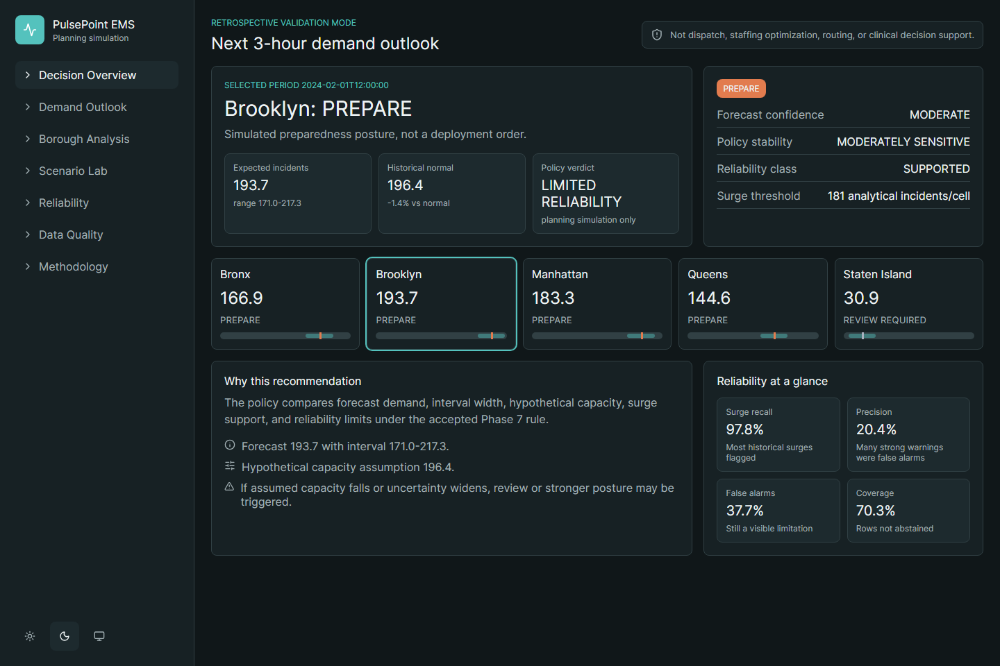
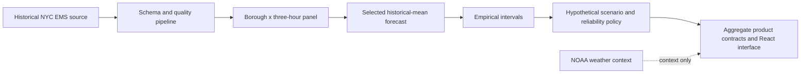
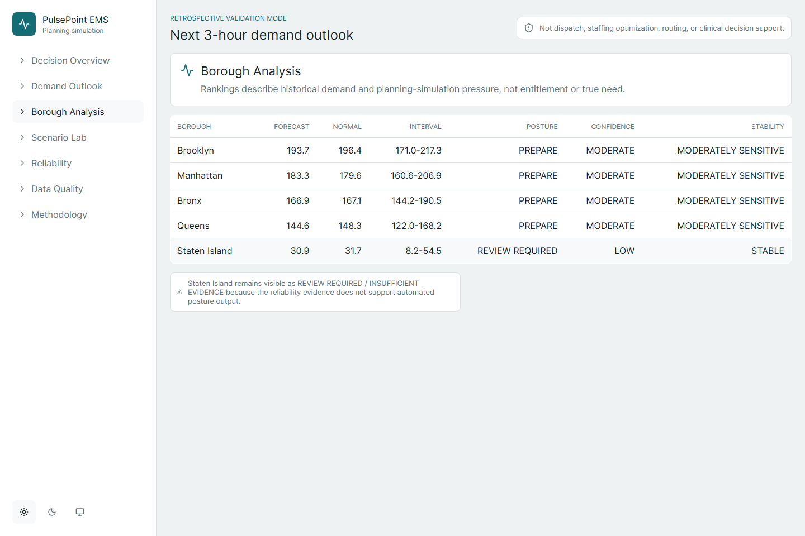
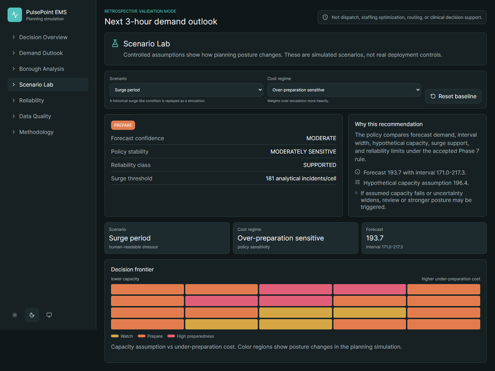

# PulsePoint EMS

**Retrospective borough × 3-hour EMS demand forecasting with uncertainty and a reliability-aware planning simulation.**

I built an analytical pipeline and product that turns historical NYC EMS data into a bounded forecast, scenario exploration and an explicit review policy. The selected forecast is an EMS-only historical mean, chosen before frozen-test evaluation because more complex candidates did not materially improve the result. The system keeps its **LIMITED_RELIABILITY** verdict visible.

The frozen forecast test achieved **MAE 10.0885**, **RMSE 13.6954** and **WAPE 0.093179**. A separate scenario-policy evaluation achieved high recall with only **0.2038 precision** and **0.3772 false-alarm rate**. Those are different evaluation populations, not interchangeable accuracy scores.

## Problem and technical difficulty

Historical incident demand is not true medical need. Time-based validation must avoid future information, surge behavior can differ from average behavior, contextual sources have different geographic/time semantics and apparent policy benefits depend on hypothetical capacity/cost assumptions. A polished interface must not turn that evidence into an operational instruction.

## What I built

A CPU-first Python/Polars/DuckDB/PyArrow pipeline with source manifests, schema harmonization, quality checks, leakage-safe target/feature boundaries, baseline/challenger comparisons, empirical uncertainty, scenario policies, reliability evaluation and a React/TypeScript/Vite analytical product.

## System architecture

[Architecture and decisions](ARCHITECTURE.md). No dispatch, live feed, staffing optimizer or clinical engine is represented.

## Engineering depth and key decisions

- Reconciled 2,011,943 historical records over 2023-01-01 through 2024-03-31.
- Selected the EMS-only forecast before frozen Jan–Mar 2024 testing.
- Retained a simple historical mean when more complex alternatives failed to justify promotion.
- Measured interval coverage separately during surges and kept undercoverage visible.
- Revised the policy while exposing low precision, false alarms, abstention and borough limitations.
- Kept weather context-only; did not imply completed Census or vulnerability joins.

## Verified results and context

| Evaluation | Saved result | Boundary |
| --- | --- | --- |
| Frozen forecast test | MAE 10.0885; RMSE 13.6954; WAPE 0.093179 | 3,640 borough/time rows, 327 surge events; not patient-level accuracy |
| Nominal 90% intervals | Overall coverage 0.905495; surge coverage 0.792049 | Surges undercovered; no probabilistic deployment guarantee |
| Scenario-policy evaluation | Recall 0.9779; precision 0.2038; false-alarm rate 0.3772 | 65,520 scenario rows, not independent incidents or the forecast detector test |
| Selectivity | Abstention 0.2966; coverage 0.7034 | LIMITED_RELIABILITY; Staten Island has zero automated policy coverage |

[Bounded results](evidence/results.json), [evidence guide](EVIDENCE.md) and [reproduction boundary](REPRODUCIBILITY.md) separate the populations and methods.

## Validation evidence

The saved final release gate passed. Current preparation reran **46 Python tests**, **6 frontend tests**, TypeScript checking and an isolated Vite product build successfully. A fresh complete dependency audit still reports two critical and one moderate tooling findings; production-only audit reports zero findings at assessment time. A recommended Vitest major upgrade was not applied automatically. Zero runtime-audit findings does not mean the development/build environment is clean. [Validation and dependency disposition](VALIDATION.md).

## Representative screenshots

Only aggregate UI views are shown, not raw incident rows. The scenario uses hypothetical capacity and is not an operational control. [Screenshot register](SCREENSHOT_REGISTER.md).

## Setup / reproduction boundary

This case-study export contains no runnable pipeline or raw data. The original project documents three levels: review/tests/product, rebuild from local validated snapshots, and reacquire official public sources. Full reproduction needs separately cleared source, Python and Node dependencies, provider availability and authorized data access. Source snapshots are deliberately not redistributed. No command here promises to recreate the original dataset from this export alone.

## Hardware / resource context

Historical validation used a Ryzen 5 5600H, 16 GB RAM and a laptop RTX 3050 with 4 GB VRAM; the analytical workload is CPU-first and did not materially require GPU acceleration. Present isolated product build produced approximately 281 KB JS / 81.5 KB gzip and 10.8 KB CSS / 2.86 KB gzip. Local build timing is not an operational forecast-serving SLA.

## Limitations

**RETROSPECTIVE VALIDATION MODE; LIMITED_RELIABILITY; Staten Island REVIEW_REQUIRED / INSUFFICIENT_EVIDENCE.** Precision is low, false alarms remain high and surge intervals undercover. No ambulance/crew availability, patient outcomes, routing model or prospective operational validation is supplied. Historical utilization is not true need. Weather is context-only; Census access is unresolved and vulnerability joins are deferred. No dispatch optimization, staffing optimization, patient outcome prediction, clinical support, causal benefit, guaranteed surge prediction or live deployment is claimed.

## Provenance / redistribution and intentional exclusions

NYC EMS is the primary historical source; NOAA weather is context-only. Public availability does not establish raw redistribution/privacy clearance. Source license, provider terms, UI/dependency attribution and the working project name require owner review. Raw EMS JSONL, bulk Parquet, provider snapshots, row-level records, environments, caches and large intermediate/generated payloads are intentionally excluded. This project is an independent analytical demonstration; no affiliation with a third-party EMS organization is asserted.

## Project status and publication scope

The engineering project is complete within the bounded scope described here. This staged repository is a **case study and evidence summary**, not a runnable source distribution. No source license is selected or granted by these documents. Publication is awaiting owner review. See [source-release decision](SOURCE_RELEASE_DECISION.md), [provenance](PROVENANCE.md), [validation](VALIDATION.md) and [file manifest](PUBLIC_EXPORT_MANIFEST.json).
